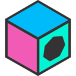
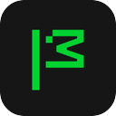

  

  

  
  
  
  

  B.Tech Computer Science student at Delhi Technological University. 
  Building AI/ML systems and LLM workflows, and contributing to open-source projects such as Grafana, kpt and Waybar.

<h2 align="center">Open Source</h2>

  Pull requests to production codebases across observability, Kubernetes tooling, workflow orchestration and the Linux desktop.

  
  

<table align="center">
  <tr>
    <th align="center" colspan="2">Project</th>
    <th align="center">Contribution</th>
    <th align="center" width="130">Pull requests</th>
  </tr>
  <tr>
    <td align="center" width="68"></td>
    <td><a href="https://github.com/grafana/grafana-pathfinder-app"><b>Grafana Pathfinder</b></a> grafana/grafana-pathfinder-app</td>
    <td>Snippet validation and caching against the catalog, guided-sequence progress and navigation fixes, cross-tab step waits tied to the live tab budget, clearer kiosk catalog errors with rejected rules counted and logged once per tier, faster e2e runs, and tighter tests for the docs panel and learning paths.</td>
    <td align="center">
      
    </td>
  </tr>
  <tr>
    <td align="center" width="68"></td>
    <td><a href="https://github.com/grafana/interactive-tutorials"><b>Grafana Interactive Tutorials</b></a> grafana/interactive-tutorials</td>
    <td>Snippet references are now validated against the generated catalog.</td>
    <td align="center">
      
    </td>
  </tr>
  <tr>
    <td align="center" width="68"></td>
    <td><a href="https://github.com/kptdev/porch"><b>Porch</b></a> kptdev/porch</td>
    <td>Added a <code>datasize</code> package so size flags accept values such as <code>6MB</code>, and recorded the creation task type in v1alpha2 commit annotations. In review: blocking lifecycle transitions after a failed render, and nil checks on task details.</td>
    <td align="center">
       
       
      
    </td>
  </tr>
  <tr>
    <td align="center" width="68"></td>
    <td><a href="https://github.com/Alexays/Waybar"><b>Waybar</b></a> Alexays/Waybar</td>
    <td>Clock module: standalone month names in the calendar header.</td>
    <td align="center">
      
    </td>
  </tr>
  <tr>
    <td align="center" width="68"></td>
    <td><a href="https://github.com/kptdev/kpt"><b>kpt</b></a> kptdev/kpt</td>
    <td>Moved the e2e test framework to <code>e2e/framework</code> as the first step of porting the <code>kpt live</code> e2e suite to Go. In review: a <code>--timeout</code> flag for <code>kpt fn render</code> and <code>kpt fn eval</code>, stopping an exec function's child processes on timeout, and two <code>kpt live init</code> fixes.</td>
    <td align="center">
       
       
       
       
      
    </td>
  </tr>
  <tr>
    <td align="center" width="68"></td>
    <td><a href="https://github.com/grafana/grafana"><b>Grafana</b></a> grafana/grafana</td>
    <td>Default for a missing repeat direction in the V1 to V2 dashboard conversion, and surfacing datasource change errors in PanelEditNext.</td>
    <td align="center">
       
      
    </td>
  </tr>
  <tr>
    <td align="center" width="68"></td>
    <td><a href="https://github.com/kestra-io"><b>Kestra plugins</b></a> kestra-io/plugin-transform kestra-io/plugin-crypto</td>
    <td>In review: comparing numbers by value in record filter expressions (<code>==</code>, <code>!=</code>, <code>in</code>), and encrypting OpenPGP messages to a usable encryption key in the key ring.</td>
    <td align="center">
       
      
    </td>
  </tr>
  <tr>
    <td align="center" width="68"></td>
    <td><a href="https://github.com/mozilla/web-ext"><b>Mozilla web-ext</b></a> mozilla/web-ext</td>
    <td>Warning about missing extension IDs when running Firefox.</td>
    <td align="center">
      
    </td>
  </tr>
</table>

  
  Also reported a <code>GOFLAGS</code> handling bug in
  <a href="https://github.com/open-telemetry/opentelemetry-go-compile-instrumentation/issues/1267">OpenTelemetry Go Compile Instrumentation</a>, since resolved.

<h2 align="center">AI / ML Projects</h2>

<table align="center" width="72%">
  <tr>
    <th align="center">Project</th>
    <th align="center">What it explores</th>
    <th align="center">Link</th>
  </tr>
  <tr>
    <td align="center"><b>Agentic Dissonance</b></td>
    <td align="center">Multi-agent LLM disagreement for volatility forecasting</td>
    <td align="center"><a href="https://github.com/Nikshay1/market-volatility-using-multiple-LLMS">Open repository</a></td>
  </tr>
  <tr>
    <td align="center"><b>RecoverFlow</b></td>
    <td align="center">Guardrailed AI workflow for failed-payment recovery</td>
    <td align="center"><a href="https://github.com/Nikshay1/AI-Payment-Failure-Recovery-Agent">Open repository</a></td>
  </tr>
  <tr>
    <td align="center"><b>AI-Enhanced Hiring</b></td>
    <td align="center">Hybrid semantic retrieval with embeddings, BM25, and cosine similarity</td>
    <td align="center"><a href="https://github.com/Nikshay1/AI-Enhanced-Hiring-Decisions">Open repository</a></td>
  </tr>
  <tr>
    <td align="center"><b>SS-DBSCAN</b></td>
    <td align="center">Semi-supervised clustering inspired by recent research</td>
    <td align="center"><a href="https://github.com/Nikshay1/SS-DBSCAN---Semi-Supervised-DBSCAN">Open repository</a></td>
  </tr>
</table>

<h2 align="center">GitHub Activity</h2>

  

<table align="center">
  <tr>
    <td width="50%">
      
    </td>
    <td width="50%">
      
    </td>
  </tr>
  <tr>
    <td width="50%">
      
    </td>
    <td width="50%">
      
    </td>
  </tr>
</table>

<h2 align="center">Stack</h2>

  

  
  
  

  

